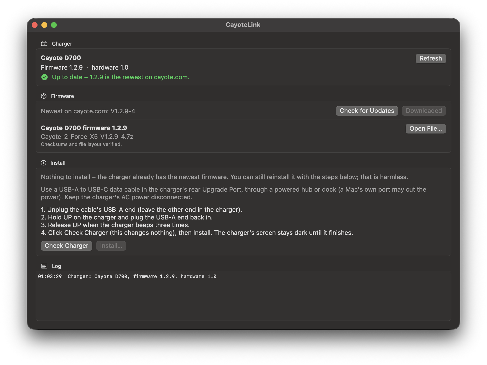

# CayoteLink

A Mac app (and command-line tool) that updates the firmware of the **Cayote 2-Force X5** charger.
It checks which firmware your charger has, finds the newest on cayote.com, and installs it, with no
Windows PC needed. It's a sister project to [NobleLink](https://github.com/trelaf/NobleLink), which
does the same job for the FlySky Noble NB4+ transmitter.



> **Vibe coded, human tested.** The USB protocol was reverse-engineered and the code written by an
> AI (Claude), working with a human who tested it on a real 2-Force X5: reading the installed
> version, and installing firmware V1.2.9. Not affiliated with Cayote or Grepow; use at your own
> risk. CayoteLink checks the firmware file and asks the charger whether it accepts it before
> anything is erased – see *Safety*.

## Why

Cayote's firmware updater only runs on Windows. We wanted to keep the charger up to date from a Mac,
so we worked out how the updater talks to the charger and wrote a small native app that does the same.

## What it does

- Shows the connected charger's model and installed firmware version, and whether it's up to date
- Checks cayote.com for the newest firmware and downloads it
- Opens Cayote's `.7z` download as is, the updater `.exe` inside it, or a bare `.grp` firmware file
- Installs the firmware exactly as Cayote's updater does, with a no-changes check first
- Runs natively on Apple-silicon and Intel Macs, no account, no network unless you ask

## Download

1. From [**Releases**](https://github.com/trelaf/CayoteLink/releases/latest), download
   `CayoteLink-…-macOS.zip`. It runs on macOS 13 or later, Apple silicon and Intel.
2. Open the zip and drag **CayoteLink** into your *Applications* folder.
3. **First launch only:** the app isn't notarized by Apple (that needs a paid developer account), so
   macOS will refuse it at first with *"Apple could not verify CayoteLink is free of malware"*.
   Click **Done**, then open **System Settings → Privacy & Security**, scroll down to
   *"CayoteLink was blocked…"*, click **Open Anyway** and confirm. After that it opens normally.

   Prefer Terminal? This does the same: `xattr -dr com.apple.quarantine /Applications/CayoteLink.app`

The command-line tool is a separate download, `cayote-…-macOS.zip`: unzip it, then run
`xattr -d com.apple.quarantine cayote` once and `./cayote help`. Each release lists SHA-256
checksums if you want to verify the files.

## Build it yourself

Needs macOS 13+ and Xcode or just the Command Line Tools (`xcode-select --install`).

```sh
git clone https://github.com/trelaf/CayoteLink.git
cd CayoteLink/CayoteLink
./scripts/build_app.sh        # → dist/CayoteLink.app and dist/cayote
open dist/CayoteLink.app
```

## Connecting the charger

- Use the **USB-C Upgrade Port on the back** of the charger, between the DC and AC inputs. The front
  USB-C port only supplies power.
- Use a **USB-A to USB-C data cable**, like the one in the box. With a USB-C to USB-C cable the Mac
  doesn't see the charger at all.
- Plug it into a **powered USB hub or dock**. During an update the charger runs from USB power, and a
  Mac's own port may switch off when it draws too much.
- Keep the charger's **AC power disconnected** while updating, as Cayote's own video says.

Connected like this, with the charger running normally, CayoteLink shows its firmware version.

## Updating

1. Unplug the cable's USB-A end, leaving the other end in the charger.
2. Hold **UP** on the charger and plug the USB-A end back in. Release when it beeps three times.
   The charger is now in update mode and its screen stays dark.
3. In CayoteLink, click **Check Charger** (changes nothing), then **Install…**. It takes about
   20 seconds, and the charger restarts by itself.

The `cayote` command does the same (`cayote info`, `cayote check-updates`, `cayote download`,
`cayote probe FILE`, `cayote install FILE`; see `cayote help`).

## Safety

- Every firmware file is checked before use: both of its checksums, the address it loads at and the
  model it's for. A damaged or wrong file is never sent.
- Before erasing, CayoteLink asks the charger who it is and runs the same compatibility check as
  Cayote's updater: model, maker, and hardware and firmware generation. Then it asks you to confirm.
- The bootloader, the part of the charger that receives updates, is never touched. So if an update
  is interrupted, put the charger back in update mode and run it again.

## Supported chargers

Tested: **Cayote 2-Force X5** (internally "Cayote D700"), hardware 1.0.1, firmware V1.2.9. Other
Grepow-made chargers may use the same protocol, but CayoteLink only accepts firmware whose model
matches the charger.

## Contributing / for AI agents

Start with [`CLAUDE.md`](CLAUDE.md) (how the code is organised, how to test without hardware, and
the rules that keep a charger safe) and [`docs/PROTOCOL.md`](docs/PROTOCOL.md) (the USB protocol,
firmware file format and update sequence, with the evidence for each claim).

## License

GPL-3.0 – see [LICENSE](LICENSE). You may use, change and share CayoteLink; shared modified versions
must also be open source under the GPL. Cayote and 2-Force are trademarks of their owners.
